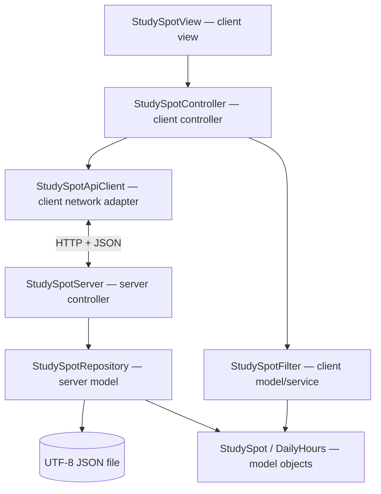

# CHUPA — Milestone 2 Architecture (Draft)

**Status:** Proposed architecture for review. Based on the [CHUPA README](https://github.com/yashab248/StudySpotFinderCPEN221A), not on an approved detailed design specification.

## 1. Architecture overview

CHUPA uses a **client–server** architecture and separates model, view, and controller responsibilities. The desktop client presents a study-space browser and sends HTTP requests to the server. The server loads a JSON dataset and returns space records. The client performs text search and filter operations on its retrieved records. No account, write API, sensor, or live crowding feed is assumed.

**Proposed external dependency:** Jackson JSON library, used by server/client adapters for reading and writing JSON. Standard Java libraries may provide HTTP and Swing. Build/dependency setup is intentionally not prescribed by these partial stubs.

## 2. Components: responsibilities, location, communication

### `StudySpot` — model, client and server
- **Responsibility:** Immutable data object for one study-space record (ID, name, building, study modes, amenities, crowding, timestamp, weekly hours).
- **Communication:** Constructed by `StudySpotRepository` and JSON conversion; consumed by `StudySpotFilter`, `StudySpotController`, and `StudySpotView`. It provides field accessors; it does not perform I/O.

### `DailyHours` — model, client and server
- **Responsibility:** Represents a day's opening and closing times or a CLOSED day.
- **Communication:** Contained by `StudySpot`; provides accessors for the UI and JSON conversion.

### `StudySpotRepository` — model, server
- **Responsibility:** Loads and validates records from the configured file; maintains an in-memory catalog indexed by unique ID.
- **Communication:** `StudySpotServer` calls `load(Path)`, `getAll()`, and `findById(String)`. `load` reads a local UTF-8 JSON file and yields either a valid catalog or a descriptive error. It never calls the client.

### `StudySpotFilter` — model/service, client
- **Responsibility:** Applies case-insensitive name/building search and conjunction of selected amenity/study-mode filters without mutating the input.
- **Communication:** `StudySpotController` calls `filter(List<StudySpot>, SearchCriteria)` and receives a filtered list.

### `SearchCriteria` — model, client
- **Responsibility:** Encapsulates text query and four boolean filter choices.
- **Communication:** `StudySpotView` passes user input to `StudySpotController`, which constructs `SearchCriteria` for `StudySpotFilter`.

### `StudySpotApiClient` — client network adapter
- **Responsibility:** Converts HTTP responses to model objects and reports network/HTTP failures.
- **Communication:** `StudySpotController` calls `fetchAll()` or `fetchById(String)`. The adapter sends `GET /api/spaces` and `GET /api/spaces/{id}` to `StudySpotServer`; it receives JSON arrays/objects or structured HTTP errors.

### `StudySpotController` — controller, client
- **Responsibility:** Coordinates loading the catalog, applying criteria, selecting a study space, and translating failures into view messages.
- **Communication:** Calls `StudySpotApiClient` to retrieve records, `StudySpotFilter` to compute search results, and `StudySpotView` to render results/details/errors. Receives `onRefresh()`, `onSearchChanged(SearchCriteria)`, and `onSpaceSelected(String)` from the view.

### `StudySpotView` — view, client
- **Responsibility:** Presents search input, filter controls, a result list, detailed information and error/empty states; does not read disk or make HTTP requests.
- **Communication:** Sends user events to `StudySpotController` by callback; the controller invokes `showResults(List<StudySpot>)`, `showDetails(StudySpot)`, `showError(String)`, and `showNoMatches()`.

### `StudySpotServer` — controller, server
- **Responsibility:** Handles incoming read-only HTTP routes, maps IDs to repository queries, and generates JSON/error responses.
- **Communication:** HTTP requests from `StudySpotApiClient` reach `handleList()` or `handleGetById(String)`; calls `StudySpotRepository.getAll()`/`findById(String)`; returns HTTP responses. Startup requires a loaded repository.

## 3. API contract (proposed)

| Request | Success | Failure |
|---|---|---|
| `GET /api/spaces` | `200` JSON array of space records | `500` on unexpected server error |
| `GET /api/spaces/{id}` | `200` JSON object | `404` JSON error for absent ID |
| Other routes | — | `404` JSON error |

`StudySpot` JSON properties: `id`, `name`, `building`, `individualStudy`, `groupStudy`, `chargingOutlets`, `accessibleEntry`, `crowding` (`LOW`, `MODERATE`, `HIGH`, `UNKNOWN`), `crowdingTimestamp` (ISO-8601 string or null), `weeklyHours` (map of `MONDAY`–`SUNDAY` to daily hours). `DailyHours` JSON has `closed` boolean, plus `opens` and `closes` as `HH:mm` strings when not closed. The timestamp must be present when crowding is known and absent when UNKNOWN. All seven days must be represented.

These shapes should be finalized alongside the JSON dataset before implementing the network layer.

## 4. Code stub locations and method contracts

**All stubs are in** `src/main/java/ca/ubc/chupa/` and its four subpackages; the table lists the exact paths. Every Java method declaration has a Javadoc description of inputs, return values, preconditions and postconditions where applicable. Methods currently throw `UnsupportedOperationException` and are intentionally not functional.

| Component | Source stub |
|---|---|
| StudySpot | `src/main/java/ca/ubc/chupa/model/StudySpot.java` |
| DailyHours | `src/main/java/ca/ubc/chupa/model/DailyHours.java` |
| SearchCriteria | `src/main/java/ca/ubc/chupa/model/SearchCriteria.java` |
| StudySpotFilter | `src/main/java/ca/ubc/chupa/model/StudySpotFilter.java` |
| StudySpotRepository | `src/main/java/ca/ubc/chupa/model/StudySpotRepository.java` |
| StudySpotApiClient | `src/main/java/ca/ubc/chupa/controller/StudySpotApiClient.java` |
| StudySpotController | `src/main/java/ca/ubc/chupa/controller/StudySpotController.java` |
| StudySpotView | `src/main/java/ca/ubc/chupa/view/StudySpotView.java` |
| StudySpotServer | `src/main/java/ca/ubc/chupa/server/StudySpotServer.java` |

## 5. Boundaries and planned implementation order

1. Define immutable models and sample valid JSON records.
2. Implement repository validation and parsing using Jackson.
3. Implement server HTTP handlers and network adapter.
4. Implement pure search/filter logic with unit tests.
5. Implement controller and graphical view, then integration tests.

**Not implemented by these stubs:** actual UI widgets, server binding, HTTP calls, parsing, persistence, and filtering algorithms. Keeping stubs unimplemented is intentional for Milestone 2. A future implementation should not mistake placeholder exceptions for working features.

## 6. Assumptions requiring team sign-off

- Desktop Java UI (rather than a browser web app).
- Client-side filtering after fetching the catalog.
- Read-only dataset; no user login, edits, or crowdsourcing.
- Jackson JSON format and HTTP endpoints above.
- Opening hours are weekly data; crowding may be stale/unknown.

See [Requirements](milestone_2_requirements.md) for the intended testable behavior. Revise both documents together when the approved design changes.
