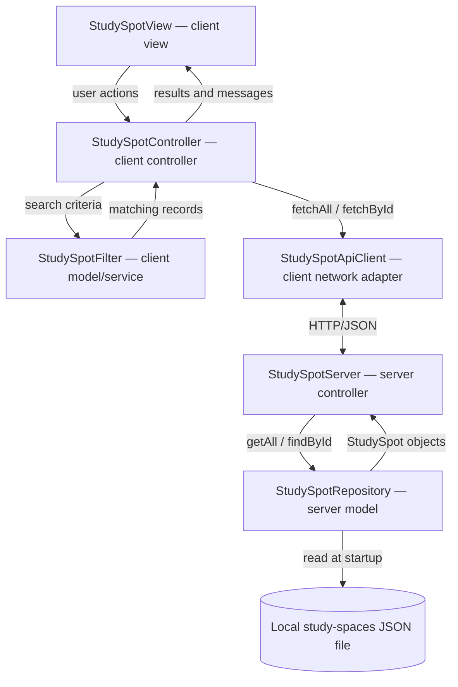

# CHUPA — Milestone 2 Architecture (MVP)

**Project:** Campus Hub for Uncrowded Places & Availability (CHUPA)  
**Reference:** [MVP requirements](milestone_2_requirements.md) and [CHUPA project README](https://github.com/yashab248/StudySpotFinderCPEN221A).  
**Status:** Proposed implementation architecture, to be confirmed against the team's design specification.

## 1. Architecture overview

CHUPA uses a **Java desktop client**, a **Java HTTP server**, and **Model–View–Controller (MVC)** separation. The server reads a **local JSON dataset** of study spaces. The desktop client requests the catalog through **CHUPA's own API** and searches/filters the received records locally. **No third-party occupancy or location API is required.**

**External library:** Jackson for JSON deserialization (and serialization). **Java standard library:** a basic Swing view is proposed; Java's built-in HTTP client and `HttpServer` can be used for communication. These are implementation choices, not additional product features.

## 2. Components and communication contracts

### `StudySpot` — Model — client and server

- **Responsibility:** Represents one study space and its ID, name, building, individual/group suitability, outlets, crowding category and weekly opening hours.
- **Communication:** `StudySpotRepository` produces `StudySpot` records; `StudySpotServer` serializes them; `StudySpotApiClient` reconstructs them; `StudySpotFilter`, `StudySpotController`, and `StudySpotView` read their properties through getters.
- **Extension fields already present in stub:** `accessibleEntry`, `crowdingTimestamp`. These are not essential MVP features; they can remain as passive fields or be removed consistently from source code later.

### `DailyHours` — Model — client and server

- **Responsibility:** Represents one day's opening interval (`HH:mm` to `HH:mm`) or a closed day.
- **Communication:** Stored inside `StudySpot`'s `Map<DayOfWeek, DailyHours>`; values are read for JSON representation and displaying weekly hours.

### `SearchCriteria` — Model — client

- **Responsibility:** Represents the current text query and selected filters (individual, group, outlets).
- **Communication:** `StudySpotController` constructs criteria from UI actions and passes them to `StudySpotFilter`. The existing stub has an extra `accessibleOnly` flag, which is an optional extension and can be left unused for MVP searching.

### `StudySpotFilter` — Model/service — client

- **Responsibility:** Takes an in-memory list of study spaces and `SearchCriteria`, returning records that satisfy the case-insensitive name/building query and all active MVP filters. Does not mutate its inputs.
- **Communication:** `StudySpotController` calls `filter(List<StudySpot>, SearchCriteria)` and receives `List<StudySpot>`.

### `StudySpotRepository` — Model — server

- **Responsibility:** Reads the JSON file at startup, transforms it into an in-memory collection of `StudySpot` objects, and supports catalog lookup by ID. Reports unreadable or unparseable files; records should be validated sufficiently to avoid crashing the application.
- **Communication:** `StudySpotServer` calls `load(Path)`, `getAll()`, and `findById(String)`. Only the repository accesses the dataset file; the client never accesses it directly.

### `StudySpotApiClient` — Networking adapter — client

- **Responsibility:** Makes HTTP GET requests to the CHUPA server and converts JSON responses into `StudySpot` objects. Distinguishes successful responses, missing IDs, and connection errors.
- **Communication:** `StudySpotController` invokes `fetchAll()` or `fetchById(String)`. Sends `GET /api/spaces` or `GET /api/spaces/{id}` to `StudySpotServer`.

### `StudySpotController` — Controller — client

- **Responsibility:** Fetches and caches the catalog, applies filters when search changes, handles selection of a result and forwards results/errors to the view.
- **Communication:** Receives UI events corresponding to `onRefresh()`, `onSearchChanged(SearchCriteria)`, and `onSpaceSelected(String)`. Calls `StudySpotApiClient`, `StudySpotFilter`, and `StudySpotView` methods `showResults`, `showDetails`, `showNoMatches`, or `showError`.

### `StudySpotView` — View interface — client

- **Responsibility:** Defines the displays required of the Java desktop view: result list, selected-space details, no-results message, and error message.
- **Communication:** The controller calls `showResults(List<StudySpot>)`, `showDetails(StudySpot)`, `showNoMatches()`, and `showError(String)`. A concrete Swing view will invoke the corresponding controller event handlers when the user refreshes, edits search/filter settings, or selects a study space. **The interface is currently a stub; actual Swing widgets and event registration are implementation work for a later milestone.**

### `StudySpotServer` — Server-side controller — server

- **Responsibility:** Starts/stops the HTTP listener, handles the two read-only endpoints, queries the repository, and serializes JSON/HTTP responses.
- **Communication:** Accepts HTTP requests from `StudySpotApiClient`, invokes `StudySpotRepository.getAll()` or `.findById(String)`, and returns `200` JSON responses or a `404` error when an ID is absent.
- **Implementation note:** The existing stub's `handleList()` and `handleGetById(String)` describe *logical* operations, not final Java `HttpExchange` callback signatures. HTTP wiring can be added during implementation without changing the MVP feature set.

## 3. CHUPA API (not a third-party API)

| Request | Successful response | Error response |
|---|---|---|
| `GET /api/spaces` | `200` and JSON array of all study spaces | `500` for unexpected server error |
| `GET /api/spaces/{id}` | `200` and JSON object of selected study space | `404` if ID does not exist |

The API is **read-only**. For example, each JSON record contains `id`, `name`, `building`, `individualStudy`, `groupStudy`, `chargingOutlets`, `crowding`, and `weeklyHours`. `crowding` is `LOW`, `MODERATE`, `HIGH`, or `UNKNOWN`; `weeklyHours` maps all seven day names to daily intervals or `CLOSED`. The existing model stub also provides `accessibleEntry` and `crowdingTimestamp` as optional implementation extensions. They are not required in the MVP UI.

**Data provenance:** Study-space attributes are manually entered from available public information or team observations, and may be incomplete or outdated. No real-time occupancy or opening-status guarantee is made.

## 4. Stub locations (all included in the existing source tree)

The following are actual Java source stubs, not fully implemented features. Their constructors/method declarations and Javadoc contracts establish component inputs, outputs, and intended behavior. Unimplemented methods may throw `UnsupportedOperationException`.

| Component | Source stub |
|---|---|
| `StudySpot` | `src/main/java/ca/ubc/chupa/model/StudySpot.java` |
| `DailyHours` | `src/main/java/ca/ubc/chupa/model/DailyHours.java` |
| `SearchCriteria` | `src/main/java/ca/ubc/chupa/model/SearchCriteria.java` |
| `StudySpotFilter` | `src/main/java/ca/ubc/chupa/model/StudySpotFilter.java` |
| `StudySpotRepository` | `src/main/java/ca/ubc/chupa/model/StudySpotRepository.java` |
| `StudySpotApiClient` | `src/main/java/ca/ubc/chupa/controller/StudySpotApiClient.java` |
| `StudySpotController` | `src/main/java/ca/ubc/chupa/controller/StudySpotController.java` |
| `StudySpotView` | `src/main/java/ca/ubc/chupa/view/StudySpotView.java` |
| `StudySpotServer` | `src/main/java/ca/ubc/chupa/server/StudySpotServer.java` |

**Stub completeness caveat:** A concrete Swing view class and a method for binding event callbacks have not been stubbed yet. The current interface describes outputs from controller to view; controller event signatures describe the reverse interaction. Adding a `StudySpotSwingView` stub and documenting its callback registration would strengthen the architecture submission, but does not add a new MVP product feature.

## 5. Implementation boundaries and order

1. Build the sample JSON study-space dataset and model objects.
2. Implement file loading using Jackson and repository lookup.
3. Implement CHUPA's two HTTP GET endpoints and Java client adapter.
4. Implement and test search/filter logic.
5. Implement the Swing view and controller event handling.

**Out of scope:** accounts, reservations, user-submitted crowding, external occupancy APIs, maps, third-party location lookups, live availability, write endpoints and database persistence.

**Design traceability:** [Requirements](milestone_2_requirements.md) identifies the verifiable MVP behaviors. If a separate Milestone 1 UI/design specification exists, link it here and ensure these component contracts cover its interactions.
